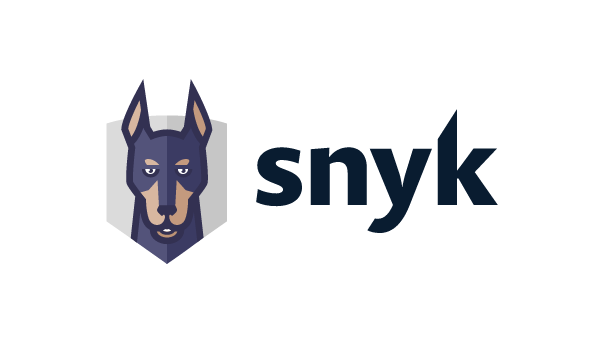
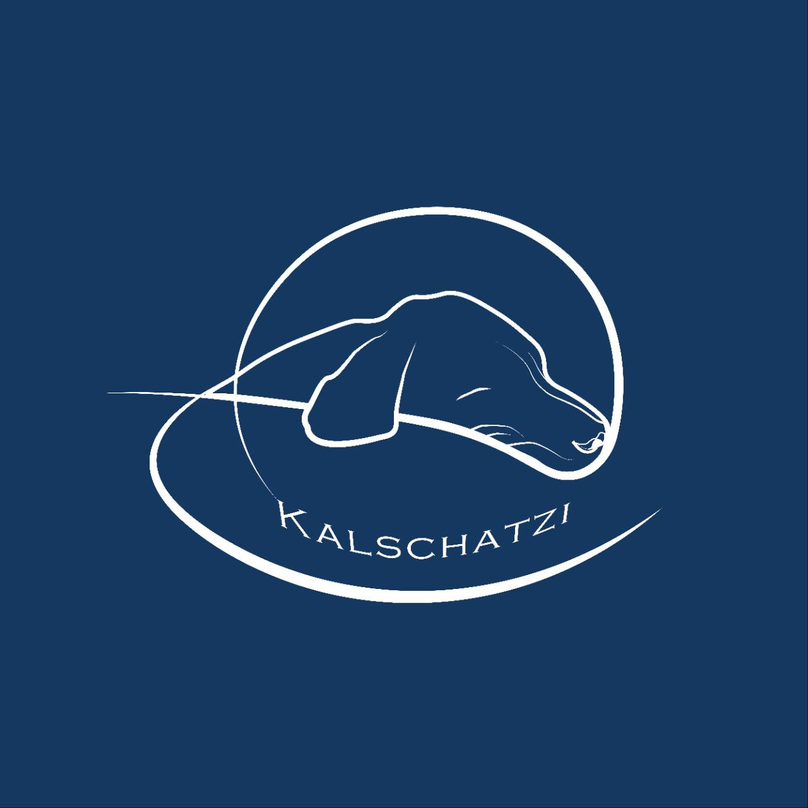

# Tiago Alves

\[[tiago@kalschatzi.com](mailto:tiago@kalschatzi.com)] • \[+351 915718324] • [LinkedIn](https://linkedin.com/in/tmcalves) • [GitHub](https://github.com/tmcalves) • [Website](https://learn.kalschatzi.com)

---

## 🧑‍💻 Summary

Staff Software Engineer with 15 years in software, specialising in AI agent platforms, cloud-native platform architecture and security. At Snyk I was one of the first two engineers in the AI Pentest department and am the principal architect of its AI-powered penetration testing service: autonomous offensive-security agents with guardrails, evals, prompt-injection handling and gVisor sandboxes. Before that, at CECG, I was principal architect, product owner and people manager for a ~15-engineer team building Tesco Bank's Internal Developer Platform. It grew from one tenant to ~50 tenant teams (250+ engineers), with security standards defined alongside the bank's security department. At Sky I helped design and scale a multi-region, active-active platform serving 60M concurrent users. Active mentor and teacher.

---

## 🛠️ Key Skills

**Architecture & Leadership:** Distributed systems, multi-tenant Internal Developer Platforms, event-driven and asynchronous architectures, build-vs-buy decisions, product ownership and roadmaps, managing through team leads, hiring, mentoring

**AI & Security:** LLM agents and orchestration, MCP and tool integration, guardrails and evals, agent sandboxing (gVisor in production, bubblewrap, seccomp; Firecracker evaluated), prompt-injection handling, threat modelling, AppSec, penetration testing tooling, security standards and governance

**Languages:** Go, Rust, Python, Java, Groovy

**Cloud & Platform:** AWS, GCP, Kubernetes (EKS, GKE, multi-region), Terraform, ArgoCD, Crossplane, Config Connector, Cilium, Envoy, GitHub Actions, Jenkins

**Data:** PostgreSQL, Redis, Cassandra, Apache Kafka

**Reliability & Observability:** SLOs, on-call and incident management, DR testing, Prometheus, Grafana, ELK, Datadog

---

## 💼 Experience

 • Snyk • **Staff Software Engineer**

*November 2025 – Present*

* One of the first two engineers in Snyk's AI Pentest department, helping scale it up.
* Drove adoption of Claude Code and Cursor: piloted it with a team of 5 in Snyk's Evo department, extended it to the AI Pentest department, and it was later adopted across Evo (~200 people). Backed it with automated validation of code quality, documentation and conformance to ADRs and task requirements.
* Principal architect for the AI-powered penetration testing service: an API server and async worker orchestrating autonomous security assessments of web applications.
* Took the service from design to general availability with paying customers in ~6 months end to end, using agentic development.
* Building autonomous offensive-security agents on production LLM APIs, with guardrails, evals and MCP-based tool integrations.
* Led threat modelling for the service and designed its agent controls: prompt-injection handling for untrusted content from target applications, tool-misuse limits, and an audit trail of agent decisions and tool calls.
* Built a hardened sandbox for running AI agents safely, using gVisor, bubblewrap, seccomp and network egress policies.
* Tech stack: Go, Rust, Python, PostgreSQL, Redis, Docker, Kubernetes, Envoy

---

 • CECG • **Lead Software Engineer** — Principal Architect, Product Owner & People Manager

*November 2021 – October 2025*

* Principal architect, product owner and people manager for ~15 engineers, half of them through team leads, building a Kubernetes-based Internal Developer Platform on AWS for Tesco Bank.
* Designed around a single tenant's needs, the platform's success and purpose-built tooling led ~50 tenant teams (250+ engineers) across the bank to onboard.
* Partnered with the bank's security department to define new security standards for cloud-native applications and built them into the platform: default-deny networking, admission policies rejecting non-compliant workloads, image scanning at build, deploy and run time, and log forwarding to the bank's SIEM.
* Owned the platform roadmap and build-vs-buy decisions, integrating the bank's existing identity, secrets, vulnerability management and SIEM tooling rather than rebuilding it.
* Built an out-of-the-box, containerised Developer Platform deployable in days.
* As principal engineer on Sky's CMS redesign, led the move from a monolith to small, isolated, independently deployable microservices.

---

 • Toptal • **Lead Software Engineer**

*February 2018 – January 2022 — freelance, alongside full-time roles*

* **Aviation maintenance app:** led mobile development and managed a team of 4 engineers, delivering the full application from design specs (Node.js, Flutter, GCP, Serverless).
* **Reinsurance company:** co-designed a modern service-oriented architecture across legacy and new systems (Nest.js, Java, Spring Boot, AWS, PostgreSQL).

---

::: {style="break-inside: avoid"}
 • Reachdesk • **Senior Software Engineer**

*January 2021 – October 2021*

* Fourth engineer at the company; helped scale to 40+ people, focusing on platform reliability and resilience with functional, integration and load test coverage.
:::

---

 • Sky PLC • **Senior Software Engineer**

*January 2016 – December 2020*

* Helped design and scale the platform to support 60M concurrent users, running active-active across regions on multiple clusters, each hosting hundreds of tenants and thousands of applications.
* Led and improved an internal Kubernetes-based PaaS, and built highly available REST APIs and CI/CD pipelines on Kubernetes for microservices.
* Migrated legacy databases, delivered zero-downtime database and API performance optimisations, and built observability dashboards in Kibana and Grafana.

---

**Earlier:** Airnav Systems, Senior Software Engineer (2012–2015): RadarBox24 flight-tracking apps (web and Android), a high-throughput Java data processing server and Redis-backed REST services. Quidgest, Software Developer (2011): PDF reporting and code-generator tooling.

---

## 🧾 Online Writing / Public Contributions

* [MVP Security for a Bank Developer Platform](https://www.cecg.io/blog/security-for-mvp/)
* [Security for a Large International Media Provider's IDP](https://www.cecg.io/blog/case-study-security-media-providers-internal-developer-platform/)
* [Supporting GCP's Private Service Access](https://www.cecg.io/blog/intra-account-connectivity/)
* [Computer Network Fundamentals](https://learn.kalschatzi.com/module2/) and [Java and OOP](https://learn.kalschatzi.com/module1/) (mentoring course material)

---

## 📂 Projects

**Market Analyser** – Self-hosted quantitative trading research platform in Go: backtesting, walk-forward validation and paper trading via Interactive Brokers.

 • **Kalschatzi's Learning Platform** – [GitHub](https://github.com/Kalschatzi) | [Site](https://learn.kalschatzi.com)

* Platform and content for a mentorship project supporting junior engineers; currently mentoring 4 students.

---

## 🎓 Education

* **Universidade Nova de Lisboa - Master's in Computer Science** — *2011–2016*
* **Wrocław University of Science and Technology - Bachelor in Computer Science (ERASMUS program)** - *2013-2014*
